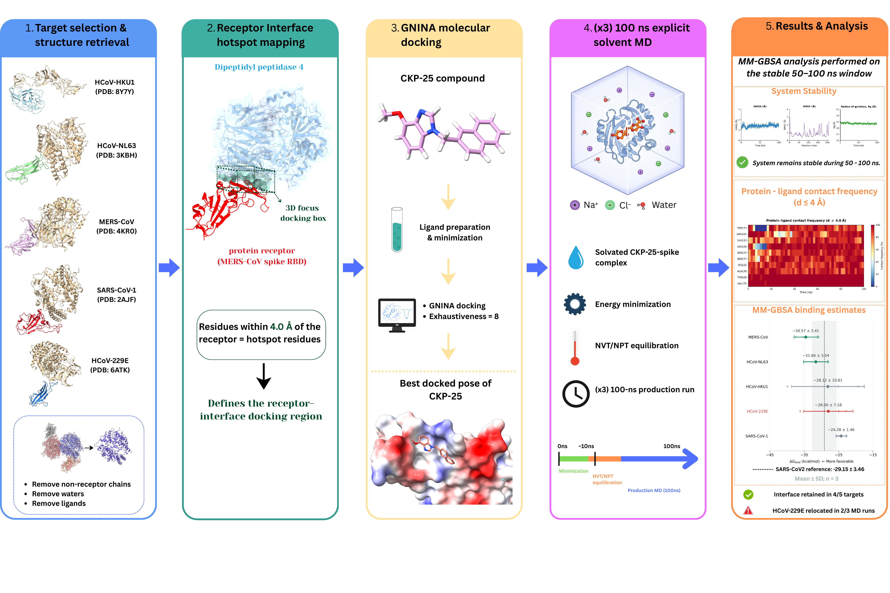
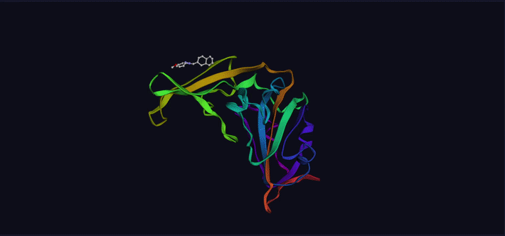

# CKP-25 Coronavirus Spike MD Workflow

[](https://www.mdpi.com/1424-8247/19/10/1664)

This repository supports a computational study; the binding behaviour reported here is predicted from simulation and has not been experimentally validated in this work.

This repository contains the curated spike-protein inputs, CKP-25 docking poses, GROMACS molecular dynamics pipeline, MM-GBSA workflow, and the analysis scripts used to generate the figures and tables in the paper.

The study covers six systems: five human coronavirus spike receptor-binding interfaces evaluated as test targets (MERS-CoV, SARS-CoV-1, HCoV-NL63, HCoV-229E, HCoV-HKU1), and the SARS-CoV-2 spike–ACE2 interface (6M0J), which is carried through the identical pipeline as an experimentally validated reference rather than as a sixth test target. Each system was simulated in three independent 100-ns replicates, so all values reported in the manuscript are means across replicates with between-replicate standard deviations.

## Workflow



High-resolution PDF: [`images/workflow.pdf`](images/workflow.pdf)

## Sample Result

Example molecular dynamics trajectory of CKP-25 bound to a coronavirus spike protein:



## Repository Layout

```text
.
├── Data/                         # Curated paper inputs: spike PDBs + CKP-25 docked poses
├── images/                       # Workflow figure for GitHub
├── paper_results/                # Lightweight processed source data
├── gromacs_files/                # Core GROMACS preparation, simulation, analysis, viewer code
├── scripts/                      # Paper-level wrappers for all six systems
│   └── create_plots/             # Aggregate plotting and paper-figure scripts
├── environment.yml               # Conda environment forreproducible runs
├── mmpbsa.in                     # AmberTools MM-GBSA input
└── extract / topology helper scripts
```

Legacy OpenMM files and raw exploratory docking folders are intentionally ignored by Git. The public workflow is the GROMACS-based workflow described in the manuscript.

## Input Systems

| System | Virus      |  PDB | Spike chain | Starting files                                                                           |
| ------ | ---------- | ---: | :---------: | ---------------------------------------------------------------------------------------- |
| MERS   | MERS-CoV   | 4KR0 |      B      | `Data/proteins/MERS_4KR0_B_spike.pdb`, `Data/docked_poses/MERS_CKP25_top_pose.sdf`   |
| SARS1  | SARS-CoV-1 | 2AJF |      E      | `Data/proteins/SARS1_2AJF_E_spike.pdb`, `Data/docked_poses/SARS1_CKP25_top_pose.sdf` |
| NL63   | HCoV-NL63  | 3KBH |      E      | `Data/proteins/NL63_3KBH_E_spike.pdb`, `Data/docked_poses/NL63_CKP25_top_pose.sdf`   |
| 229E   | HCoV-229E  | 6ATK |      E      | `Data/proteins/229E_6ATK_E_spike.pdb`, `Data/docked_poses/229E_CKP25_top_pose.sdf`   |
| HKU1   | HCoV-HKU1  | 8Y7Y |      A      | `Data/proteins/HKU1_8Y7Y_A_spike.pdb`, `Data/docked_poses/HKU1_CKP25_top_pose.sdf`   |
| SARS2  | SARS-CoV-2 | 6M0J |      E      | `Data/proteins/SARS2_6M0J_E_spike.pdb`, `Data/docked_poses/SARS2_CKP25_top_pose.sdf` |

`SARS2` is the reference system. CKP-25 has reported activity at the SARS-CoV-2 spike
interface, so this system is used to calibrate the MM-GBSA scale and to check that the
docking protocol recovers a known binding mode. The ACE2 partner chain is removed after
the receptor-recognition hotspot has been mapped, exactly as the host receptor or entry
mediator is removed for the five test targets. No parameter differs from the test-target
protocol.

Machine-readable mapping: [`Data/metadata.tsv`](Data/metadata.tsv)

## Installation

Create and activate the Conda environment:

```bash
conda env create -f environment.yml
conda activate gromacs_md
```

Check that GROMACS is available:

```bash
gmx --version
```

The environment installs GROMACS, ACPYPE, AmberTools, PDBFixer/OpenMM, RDKit, MDTraj, ParmEd, NumPy, Matplotlib, and tqdm.

## Run One System

Use this as a smoke test before launching all 100 ns simulations:

```bash
bash gromacs_files/run_MD_gromacs.sh \
  Data/proteins/MERS_4KR0_B_spike.pdb \
  Data/docked_poses/MERS_CKP25_top_pose.sdf \
  1 \
  runs/MERS_demo_1ns
```

The runner performs:

1. Protein cleanup with PDBFixer.
2. Protein topology with `amber99sb-ildn` and TIP3P water.
3. Ligand parametrization with ACPYPE/GAFF2 and AM1-BCC charges.
4. Dodecahedral solvation box and 0.15 M NaCl.
5. Energy minimization, 100 ps NVT, 100 ps NPT, production MD.
6. RMSD, RMSF, radius of gyration, contact plots, and an offline HTML trajectory viewer.

## Reproduce the Paper MD Runs

```bash
bash scripts/run_all_md.sh 100 runs
```

This runs one 100-ns trajectory for each of the six systems. Outputs are written to
`runs/` and are ignored by Git because trajectory and topology files are large.

The manuscript reports three independent replicates per system, eighteen trajectories in
total. Replicates repeat this same protocol from the same docked starting pose and differ
only in their stochastic inputs: the initial atomic velocities (`gen-vel = yes`,
`gen-seed = -1`), the V-rescale thermostat seed (`ld-seed = -1`), and the placement of
neutralising counterions by `gmx genion`. Because every seed is drawn at run time,
repeating the command above produces an independent replicate without any change to the
pipeline. The per-replicate seeds actually used, and the per-replicate values behind every
mean reported in the paper, are listed in the Supplementary Material.

## Processed Paper Results

Lightweight numerical source data are provided in `paper_results/`. These files
include processed selected-pose docking scores, docking search-box coordinates,
MD stability/contact metrics, residue contact frequencies, and MM-GBSA
summaries/per-frame delta energies. Raw docking logs, full trajectories, binary
GROMACS outputs, checkpoints, and large intermediate files are intentionally
excluded.

These files cover all six systems but correspond to a single trajectory per system. They
are not the replicate-averaged values reported in the manuscript. Tables 2 and 3 of the
paper report means and between-replicate standard deviations over three replicates, and
the full per-replicate breakdown is given in the Supplementary Material rather than here.

To regenerate the processed tables from local completed simulations:

```bash
python scripts/export_paper_results.py --results-dir runs --out-dir paper_results
```

## Generate MD Analysis Figures

```bash
bash scripts/run_all_analysis.sh runs paper_figures 100
```

This generates:

- Per-system plots: H-bonds/polar contacts, protein and ligand RMSD, RMSF, Rg.
- Offline 3D trajectory viewers in each run folder.
- `paper_figures/md_metrics_summary.md`
- `paper_figures/*_metrics.png`
- `paper_figures/md_rmsf_rg_stability.jpg`
- `paper_figures/md_polar_contacts_stability.jpg`
- `paper_figures/md_contact_heatmap_4panel.jpg`
- `paper_figures/md_contact_heatmap_5panel.jpg`
- `paper_figures/md_contact_heatmap_6panel.jpg` (the manuscript figure; includes the SARS-CoV-2 reference panel)

## Run MM-GBSA

Prepare Amber-compatible topology and trajectory files:

```bash
bash scripts/prepare_mmpbsa_inputs.sh runs
```

Run MM-GBSA with AmberTools:

```bash
bash scripts/run_mmpbsa_all.sh runs
```

Plot the MM-GBSA binding free-energy summary:

```bash
python scripts/create_plots/plot_mmpbsa_bar.py --results-dir runs --out-dir paper_figures
```

## Simulation Settings Encoded in the Pipeline

| Step                | Setting                                                                                                                     |
| ------------------- | --------------------------------------------------------------------------------------------------------------------------- |
| Docking             | GNINA 1.3, exhaustiveness 8; poses ranked by CNN pose score, with a Vina affinity below -5.0 kcal/mol as a secondary filter |
| Protein force field | AMBER99SB-ILDN                                                                                                              |
| Ligand force field  | GAFF2 via ACPYPE                                                                                                            |
| Ligand charges      | AM1-BCC                                                                                                                     |
| Water model         | TIP3P (`spc216.gro`)                                                                                                      |
| Salt                | 0.15 M NaCl, neutralized                                                                                                    |
| Box                 | Dodecahedron, 1.2 nm margin                                                                                                 |
| Energy minimization | Steepest descent, 50,000 steps                                                                                              |
| NVT                 | 100 ps, V-rescale thermostat, 300 K                                                                                         |
| NPT                 | 100 ps, V-rescale thermostat, Parrinello-Rahman barostat, 1 bar                                                             |
| Production          | 2 fs timestep, PME electrostatics, 100 ns for manuscript runs                                                               |
| Replicates          | 3 independent runs per system (18 trajectories); seeds drawn at run time                                                    |
| MM-GBSA             | AmberTools`MMPBSA.py`, GB model `igb=2`, 0.150 M salt                                                                   |

## Third-Party Software

This repository contains workflow scripts and curated inputs. It does not
redistribute GROMACS; the pipeline calls the user-installed `gmx` executable
from the Conda environment. GROMACS is distributed by its developers under the
GNU LGPL v2.1 license. If you use this workflow, please also cite the
appropriate GROMACS version and papers according to the official GROMACS
citation metadata.

The offline trajectory viewer bundles `3Dmol-min.js` and `jquery.min.js`.
Their license notices are retained in `gromacs_files/`.

## License

This project is licensed under the MIT License. See [`LICENSE`](LICENSE) for details.

## 📍Citation

```
@article{papadopoulos2026computational,
  title={Computational Assessment of CKP-25 Binding at Receptor-Recognition Interfaces Across Diverse Human Coronaviruses},
  author={Papadopoulos, Angelos-Michail and Petrakis, Spyros and Alvarez, Federico and Daras, Petros},
  journal={Pharmaceuticals},
  year={2026},
  publisher={Multidisciplinary Digital Publishing Institute}
}
```
